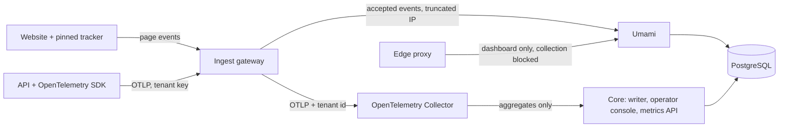

# Astrolabe

> Named Parallax until 20 November 2026. Internal identifiers (`parallax` schema, `PARALLAX_` variables, `parallax.js`) and the demo addresses keep the old name for now.

Privacy-first web and API analytics for projects building on Stellar. One shared service,
measured the same way for everyone, so usage numbers do not have to be self-reported.

Built on [Umami](https://github.com/umami-software/umami) (unmodified, pinned) and the
[OpenTelemetry Collector](https://opentelemetry.io/docs/collector/) (unmodified, pinned).

> **Status: working prototype.** Everything described under "What works today" runs from this
> repository with one command and is covered by tests. It is not yet a production service; the
> gaps are listed under "Known limits" and nothing here should be read as more than that.

## Live demo

The prototype is online. Nothing to install.

| | |
| --- | --- |
| **Start here** | https://parallax.agentposhq.com |
| Live readings, every project side by side | https://parallax.agentposhq.com/operator |
| What a project sees (public dashboard of the demo wallet) | https://parallax.agentposhq.com/share/demowallet |
| Infrastructure map, in English, Spanish and Portuguese | https://parallax.agentposhq.com/map |
| Two measured demo sites | https://demo.parallax.agentposhq.com and https://explorer-demo.parallax.agentposhq.com |
| A Horizon-shaped demo API that reports through OpenTelemetry | https://api-demo.parallax.agentposhq.com |
| The same readings as JSON | https://parallax.agentposhq.com/api/v1/projects |

Three things to try, with the live readings open in another tab:

**A real visit is counted.** Open https://demo.parallax.agentposhq.com and click around.

**A forged visit is turned away.** The website id is public, like any analytics id:

```sh
curl -s -X POST https://ingest.parallax.agentposhq.com/e \
  -H 'Origin: https://demo.parallax.agentposhq.com' \
  -d '{"type":"event","payload":{"website":"9b3ee96b-f163-462c-a176-1b9a0d3e9fe2","url":"/"}}'
# {"code":"missing-token","message":"The event has no valid browser token.", ...}
```

**An API is measured without storing the address.**

```sh
curl -s https://api-demo.parallax.agentposhq.com/accounts/GA5ZSEJYB37JRC5AVCIA5MOP4RHTM335X2KGX3IHOJAPP5RE34K4KZVN/payments
```

About 15 seconds later the readings list one more request to `GET /accounts/{account}/payments`.

The demo runs on one server with 1 shared vCPU and 2 GB of memory. On that server the API path
took 200 requests per second for five minutes with nothing lost: [load test](docs/load-test.md).

## What works today

| | |
| --- | --- |
| **Web analytics** | A versioned tracker with no cookies sends page views and named events. Umami stores them and gives each project its dashboard. |
| **Inflation defense** | Events are accepted only from the domains a project registered, and only with a short-lived token the browser earns by running a computation. A plain `curl` loop is rejected, and the rejection is counted. |
| **Traffic classes** | Every event is classified as confident, low confidence or automated. Nothing is silently dropped: operators see all classes, and the rejections, per project. |
| **API analytics** | A project adds Astrolabe as a second OpenTelemetry destination. The Collector counts requests and durations per route, then drops the traces. Only aggregates are stored. |
| **Path normalization** | Stellar accounts (`G…`), contracts (`C…`), muxed accounts (`M…`), assets, hashes, UUIDs and numeric IDs are replaced by placeholders before anything is stored. |
| **Tenant isolation** | API aggregates are protected by PostgreSQL row-level security: a tenant session can read only its own rows. |
| **Operator view** | One page, and one JSON endpoint, with every project side by side. |

## Run it on your own machine

Requirements: Docker with Compose. Nothing else. The addresses below are local ones; the public
demo is in the section above.

```sh
cp .env.example .env        # then replace every value with a random secret
docker compose --profile demo up -d --build
```

| URL | What it is |
| --- | --- |
| http://localhost:8090 and http://localhost:8092 | Two demo websites, one per demo project |
| http://localhost:8091 | A Horizon-shaped demo API that dual-exports OpenTelemetry |
| http://localhost:8081 | Landing page, with the operator console at `/operator` |
| http://localhost:3000 | Umami dashboards (user `admin`, password `UMAMI_ADMIN_PASSWORD`) |
| http://localhost:8080 | Ingest gateway |

Set `PARALLAX_OPERATOR_PUBLIC=true` in `.env` to open the operator console without a key
(demo only). Otherwise send `Authorization: Bearer $PARALLAX_OPERATOR_KEY`.

## The same checks, locally

With the stack running on your machine:

**1. A real visit is counted.** Open http://localhost:8090, click a few links, then open the
operator console. The browser's network tab shows a challenge, a token, and one event per page.
No cookie is set.

**2. A forged visit is rejected.** Take the website id from the page source and try to add
traffic from a terminal:

```sh
curl -s -X POST http://localhost:8080/e \
  -H 'Origin: http://localhost:8090' \
  -d '{"type":"event","payload":{"website":"<WEBSITE_ID>","url":"/"}}'
# {"code":"missing-token","message":"The event has no valid browser token.", ...}
```

The operator console now shows one rejected event for that project, with the reason. Going
around the gateway does not work either:

```sh
curl -s -X POST http://localhost:3000/api/send -H 'content-type: application/json' -d '{}'
# {"code":"direct-collection-disabled", ...}
```

**3. An API is measured without storing traces.** Call the demo API with any Stellar address:

```sh
curl -s http://localhost:8091/accounts/GA5ZSEJYB37JRC5AVCIA5MOP4RHTM335X2KGX3IHOJAPP5RE34K4KZVN/payments
```

About 15 seconds later the operator console lists `GET /accounts/{account}/payments` with its
request count and 95th percentile latency. The address is nowhere in the database:

```sh
docker compose exec db psql -U parallax -d parallax -c 'select route, sum(calls) from parallax.api_minute group by 1'
```

**4. Two projects side by side.** http://localhost:8081/operator, or as JSON:
`curl -H "Authorization: Bearer $PARALLAX_OPERATOR_KEY" http://localhost:8081/api/v1/projects`.

**5. All of the above, automated.** `node --env-file=.env scripts/smoke.ts` runs these checks
against the running stack. CI runs it on every push.

## How it fits together



- **`apps/gateway`**: the only way in. Serves the tracker at a versioned, immutable URL; checks
  origin and token; classifies; truncates the IP address before anything else sees it;
  authenticates OTLP by tenant key.
- **`deploy/collector`**: Collector configuration, generated from the path rule set. Keeps
  server spans, normalizes the route, strips every other attribute, derives request count and
  duration histogram, drops the spans. Tenant metrics and logs are dropped.
- **`apps/core`**: writes API aggregates, serves the operator console and the JSON APIs, owns
  the `parallax` schema and its row-level security policies.
- **`packages/path-rules`**: one rule set used by both the Collector (RE2) and the writer
  (JavaScript), so a path is normalized twice, the same way.
- **`deploy/edge`**: closes Umami's own collection endpoints, which accept events for any
  website id from anywhere.

A trilingual infrastructure map of the proposed production design is in
[`docs/infrastructure-map.html`](docs/infrastructure-map.html).

## What is stored, and what never is

Stored: page views, visitors, referrers, session data Umami derives (browser, OS, device,
country), event counts per traffic class and rejection reason, and per-minute API aggregates
(request count, duration sum and histogram) per service, method, normalized route and status.

Never stored: full IP addresses (IPv4 is cut to /24 and IPv6 to /48 inside the gateway, before
the event is forwarded), cookies or cross-site identifiers, traces, spans, logs, span
attributes, raw API paths.

## Installing the tracker

```html
<script defer src="https://INGEST_HOST/v/0.1.0/parallax.js"
        data-website="YOUR_WEBSITE_ID"
        integrity="sha384-…" crossorigin="anonymous"></script>
```

There is no `latest` URL. The integrity hash for a release is printed by
`node scripts/sri.ts`. Upgrading is a change to the version and the hash in your own code.

Named events: `parallax.track("signup", { plan: "free" })`.

## Sending API telemetry

Keep your own exporter and add a second one. Only the endpoint and the header are specific to
Astrolabe ([`examples/sample-api/otel.cjs`](examples/sample-api/otel.cjs)):

```
endpoint: https://INGEST_HOST/otlp/v1/traces
header:   Authorization: Bearer <project key>
```

## Known limits

Stated plainly, because a measurement service is only useful if its limits are known.

- **The browser token raises cost; it does not prove a human.** A script that runs the same
  computation from a registered origin's name is accepted (the smoke test does exactly this).
  It is classified, counted and rate-limited, not made impossible. A determined actor driving
  real browsers can still inflate numbers.
- **Automated events do not reach Umami.** They are counted at the gateway only. Low-confidence
  events do reach Umami; filtering them out of tenant dashboards by default is not built yet.
- **Location granularity.** Umami stores region and city when it can resolve them. Country-only
  storage needs work on top of Umami and is not done.
- **Not implemented yet:** data-center network detection, self-service enrollment, operator API
  keys, gRPC ingestion, metrics derived from a tenant's own HTTP metrics, rollups and retention
  jobs, high availability, backups, infrastructure as code.
- **Rate limits are per gateway node** and live in memory.
- **Challenges are stateless** and can be reused until they expire (120 seconds).
- **Images are pinned by version tag**, not yet by digest.
- **The tracker** records page views and named events only.

## Development

```sh
pnpm install
pnpm test            # unit and handler tests
pnpm typecheck
pnpm gen:collector   # regenerate deploy/collector/config.yaml after changing path rules
```

Node 24 runs the TypeScript sources directly; there is no build step.

## License

MIT. See [LICENSE](LICENSE).
